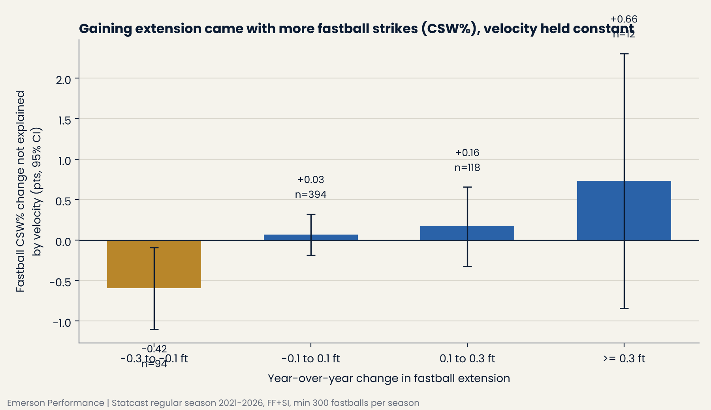
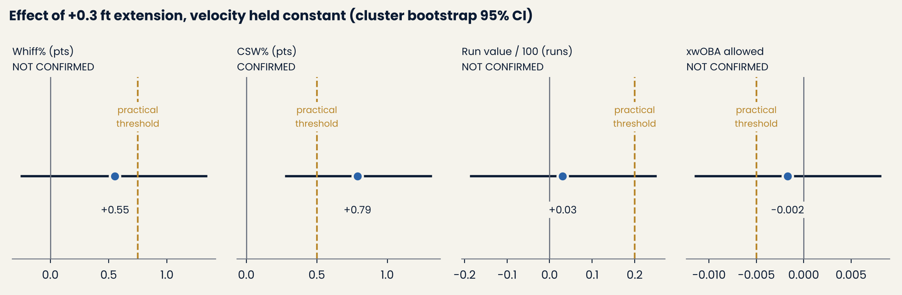

# EP Pitcher Extension | Extensión del Pitcher

**Emerson Performance (EP)** · Emerson Jimenez · Statcast 2021–2026

> **EN — Headline:** When a pitcher gained **+0.3 ft of fastball extension** from one season to the next, his fastball came with **+0.79 points of CSW%** (95% CI +0.28 to +1.31), with velocity held constant. That is about the same CSW gain that came with **+1.4 mph** of velocity. It did **not** come with less damage (xwOBA, run value), and it did not improve whiff projections.
>
> **ES — Titular:** Cuando un pitcher ganó **+0.3 pies de extensión** con la recta de una temporada a la siguiente, su recta vino con **+0.79 puntos de CSW%** (IC 95% +0.28 a +1.31), con la velocidad constante. Eso es más o menos lo mismo que vino con **+1.4 mph** de velocidad. **No** vino con menos daño (xwOBA, run value), y no mejoró la proyección de whiffs.



| Outcome (per +0.3 ft, velo held constant) | Effect | 95% CI (cluster bootstrap) | BH q | Label |
|---|---|---|---|---|
| CSW% (called + swinging strikes per pitch) | **+0.79 pts** | +0.28 to +1.31 | 0.009 | `CONFIRMED` |
| Whiff% (whiffs per swing) | +0.55 pts | −0.25 to +1.34 | 0.33 | `NOT CONFIRMED` |
| Run value per 100 fastballs | +0.03 | −0.18 to +0.25 | 0.78 | `NOT CONFIRMED` |
| xwOBA allowed on fastballs | −0.002 | −0.011 to +0.008 | 0.78 | `NOT CONFIRMED` |

618 year-over-year pairs (343 pitchers), regular-season four-seamers and sinkers, minimum 300 fastballs in each season.



---

## EN

### The decision question
**Is extension worth training in the offseason, and what should a club expect if a pitcher gains it?**

### What a front office can take from this
1. **Extension is a real lever for strikes, not for damage.** A gain came with more called and swinging strikes on the fastball. It did not come with less contact quality allowed. Value it as a strike-throwing tool, not a run-prevention fix.
2. **It is independent of velocity.** Year-over-year changes in extension and velocity barely move together (r = 0.06). A pitcher can gain one without the other, so they are two separate training targets.
3. **Big changes are rare, and when they happen they stick.** The typical change is small (SD 0.12 ft); only 1.9% of pairs gained 0.3 ft or more. Changes do not bounce back the next year (slope −0.03). So a club should expect small gains, but gains that hold.
4. **A big drop is a health flag.** All 5 pairs that lost 0.3 ft or more also had a long absence (IL or option) in one of the two seasons. `INTERPRETATION`: n = 5, so this is a monitoring cue, not a finding.
5. **Do not add extension to a whiff projection model.** Out of sample, adding it did not reduce error (MAE change +0.0002, CI −0.015 to +0.014).

### Pre-registered criteria (fixed before running the real data)
- Practical unit: +0.3 ft of average fastball extension.
- `CONFIRMED` = Benjamini–Hochberg q < 0.05 across 4 outcomes **and** the effect of +0.3 ft reaches: Whiff% ≥ +0.75 pts, CSW% ≥ +0.50 pts, RV/100 ≥ +0.20, xwOBA ≤ −0.005.
- Groups: gained ≥ 0.3 ft, lost ≥ 0.3 ft, stable < 0.1 ft.

### Method
- **Data:** Baseball Savant pitch-level search, FF + SI, `game_type == "R"`, 2021–2026 (`src/pull_data.py`).
- **Unit:** pitcher-season profile → year-over-year pairs (2021→22 … 2025→26).
- **Model (within pitcher):** Δoutcome ~ Δvelocity + Δextension + baseline outcome (regression to the mean) + season-pair fixed effects. Standard errors clustered by pitcher; 2,000-resample cluster bootstrap for the CIs.
- **Projection test:** leave-one-pitcher-out cross-validation, velocity-only model vs velocity + extension, paired cluster bootstrap on the MAE difference.
- **Known-answer test:** `tests/test_synthetic.py` plants an effect of +4, −4 and 0 whiff points per foot; the model recovers all three (PASS).

### Natural baseline (what happens without intervention)
| Check | Result |
|---|---|
| Split-half reliability of season extension (odd vs even games) | r = 0.996 |
| Smallest real season-to-season change (MDC95) | 0.05 ft |
| SD of year-over-year change | 0.12 ft |
| Pairs gaining ≥ 0.3 ft / losing ≥ 0.3 ft (primary sample) | 1.9% / 0% |
| Next-year change regressed on this-year change | slope −0.03 (gains hold) |
| Gainers ≥ 0.3 ft that kept at least half the gain next year | 6 of 7 |

### Alternative explanations checked
| Filter / control | CSW% per +0.3 ft | p |
|---|---|---|
| Primary (absence filter + manual exclusions) | +0.79 | 0.002 |
| All pairs, no absence filter (n = 1,335) | +0.50 | 0.008 |
| Without role changes (SP↔RP) | +0.72 | 0.007 |
| Without team changes | +0.82 | 0.004 |
| Without arm-angle changes ≥ 5° | +0.95 | < 0.001 |
| Arm-angle change as a control | +0.82 | 0.002 |
| Without 2022→2023 (league-wide +0.08 ft shift, pitch-clock year) | +0.73 | 0.019 |
| Relievers only | +0.94 | 0.017 |
| Starters only | +0.42 | 0.24 (not significant) |

The direction held in every check. Starters alone did not reach significance. The 2023 jump in league-average extension is absorbed by the season-pair fixed effects. Full table: `results/sensitivity.csv`; biggest movers with their flags: `results/case_table.csv`.

Injury and absence filter: automatic (≥ 30-day gap between appearances, or ≥ 21 days missed at the end of the season) plus manual (`data/injury_exclusions.csv`, with public sources). Pete Fairbanks 2025→2026 is excluded manually (nerve irritation, thoracic outlet syndrome surgery).

### Biomechanics interpretation — `INTERPRETATION`
Extension is where the ball leaves the hand, measured from the rubber. It mostly comes from stride length and how far the trunk travels over a firm lead leg.
- In professional pitchers, landing with a more open pelvis came with a longer stride, more lead-knee extension and higher ball velocity, without more elbow varus torque (Dowling et al., 2022).
- An early study in professional pitchers found stride length tracked ball speed (r = 0.73), but with a small sample (Montgomery & Knudson, 2002, as cited by van Trigt et al., 2018). In elite youth pitchers, stride length as a percent of height was not associated with ball speed; lead-knee angle at ball release was (van Trigt et al., 2018).
- Changing stride length by ±25% changed lower-body joint loads and energy cost (Crotin & Ramsey, 2015; Ramsey & Crotin, 2022). Longer is not free.

Why strikes and not damage: extension adds about **1.8 mph of perceived velocity per foot** (R² = 0.75 in this data — this is close to definitional, because Statcast computes perceived velocity from extension). Less reaction time can plausibly produce more late takes and misses, but hitters who make contact still see the same pitch shape.

### Training application — `INTERPRETATION`
For a pitcher whose extension is below what his body and delivery allow:
1. **Hip mobility:** lead-hip internal rotation and trail-hip extension, so the stride can lengthen without the pelvis opening early.
2. **Lead-leg block:** eccentric and isometric single-leg strength (split squats, single-leg RDL, lateral lunges) to stop the stride and let the trunk travel over it.
3. **Adductor and groin capacity:** longer strides load the groin; build it before asking for length.
4. **Lateral and rotational power:** lateral bounds, med-ball scoop throws from the stride position.
5. **Delivery work:** stride-length targets in bullpens, increased gradually (5% blocks), monitored with velocity and command so the change does not cost strikes elsewhere.

### Monitoring metric
- **Statcast average fastball extension**, rolling by outing, against the pitcher's own baseline.
- A season-level change above **0.05 ft** is beyond measurement noise; above **0.10 ft** is meaningful.
- A **drop** of 0.2 ft or more should trigger a health check before a mechanical fix (see point 4 above).

### 2027 watch list (post-hoc, not a test)
No pitcher in the primary sample lost ≥ 0.3 ft from 2025 to 2026, so this list uses losses ≥ 0.15 ft (≈ 3× MDC). Injury searches were done for the names marked ✓; check the others before using them as cases.

| Pitcher | 2026 team | Role | Ext 2025 → 2026 (ft) | Δ velo (mph) | Δ arm angle (°) | Notes |
|---|---|---|---|---|---|---|
| Sean Burke ✓ | CWS | SP | 7.08 → 6.83 | +0.35 | −2.5 | No 2026 IL found; bulk-relief usage |
| Freddy Peralta ✓ | NYM/TB | SP | 6.80 → 6.57 | −0.43 | −5.0 | Two trades; no 2026 IL found |
| Grant Taylor ✓ | CWS | RP | 7.41 → 7.17 | −0.39 | −1.1 | Groin strain Sep 2025; opener role |
| Daniel Lynch IV | KC | RP | 6.67 → 6.43 | +0.16 | +3.6 | |
| Yohan Ramírez | PIT | RP | 7.14 → 6.92 | −0.01 | −3.8 | |
| Jacob Latz | TEX | RP | 6.67 → 6.50 | +0.56 | +2.5 | |
| Lake Bachar | MIA | RP | 6.09 → 5.92 | −0.48 | +2.6 | |
| Orion Kerkering | PHI | RP | 6.41 → 6.25 | −0.29 | +2.4 | |
| Cade Cavalli | WSH | SP | 6.55 → 6.39 | −0.40 | −7.4 | Arm-angle change |
| Aroldis Chapman | BOS | RP | 7.27 → 7.12 | −1.43 | +0.1 | Velo also down |

Full list: `results/offseason_targets_2027.csv`.

### Limitations
- Observational: "came with", not "caused". No design isolates extension from everything else that changes in an offseason.
- Season averages; extension within a game (fatigue) is not modeled.
- Pitch shape (movement, spin) is not in the model; an extension change can come with a shape change.
- Groups with ≥ 0.3 ft are small (12 gainers, 0 losers in the primary sample); the continuous model carries the result.
- Height and body size are not in Statcast; between-pitcher differences (+2.3 whiff pts per ft) are partly body size, which is why the decision test is within pitcher.

### Corrections log
- v1.0 (Nov 2026): first release. No corrections yet.

### Reproduce
```bash
pip install -r requirements.txt
python src/pull_data.py          # ~20 min, ~2M fastballs, not committed
python src/build_features.py
python tests/test_synthetic.py   # known-answer test
python src/analysis.py           # ~6 min (bootstraps)
python src/charts.py
```

---

## ES

### La pregunta de decisión
**¿Vale la pena entrenar la extensión en la offseason, y qué puede esperar un club si un pitcher la gana?**

### Qué se lleva un front office
1. **La extensión sirve para strikes, no para daño.** Ganarla vino con más strikes cantados y abanicados con la recta. No vino con menos calidad de contacto permitida. Hay que valorarla como herramienta para tirar strikes, no como solución para prevenir carreras.
2. **Es independiente de la velocidad.** Los cambios de extensión y de velocidad casi no se mueven juntos (r = 0.06). Un pitcher puede ganar una sin la otra: son dos objetivos de entrenamiento distintos.
3. **Los cambios grandes son raros, y cuando pasan se mantienen.** El cambio típico es pequeño (DE 0.12 pies); solo el 1.9% de los pares ganó 0.3 pies o más. Los cambios no se devuelven al año siguiente (pendiente −0.03). Hay que esperar ganancias pequeñas, pero que se quedan.
4. **Una caída grande es una alerta de salud.** Los 5 pares que perdieron 0.3 pies o más tuvieron también una ausencia larga (IL o bajada a las menores) en una de las dos temporadas. `INTERPRETATION`: n = 5, es una señal para monitorear, no un hallazgo.
5. **No agregar la extensión a un modelo de proyección de whiffs.** Fuera de muestra, agregarla no redujo el error (cambio en MAE +0.0002, IC −0.015 a +0.014).

### Criterios fijados antes de correr los datos reales
- Unidad práctica: +0.3 pies de extensión promedio de la recta.
- `CONFIRMED` = q de Benjamini–Hochberg < 0.05 en los 4 resultados **y** que el efecto de +0.3 pies llegue a: Whiff% ≥ +0.75 pts, CSW% ≥ +0.50 pts, RV/100 ≥ +0.20, xwOBA ≤ −0.005.

### Método
- **Datos:** búsqueda de Baseball Savant pitcheo a pitcheo, FF + SI, temporada regular, 2021–2026.
- **Modelo (cada pitcher contra sí mismo):** Δresultado ~ Δvelocidad + Δextensión + nivel inicial (regresión a la media) + efectos fijos por par de temporadas. Errores agrupados por pitcher; bootstrap por pitcher con 2,000 remuestreos.
- **Prueba de proyección:** validación cruzada dejando fuera a un pitcher a la vez; modelo solo con velocidad vs velocidad + extensión.
- **Prueba de respuesta conocida:** `tests/test_synthetic.py` recupera efectos de +4, −4 y 0 (PASS).

### Línea base natural, explicaciones alternativas y filtros
Ver las tablas de la sección en inglés. Resumen: la extensión se mide con mucha precisión (r = 0.996 entre mitades de temporada; cambio mínimo real de 0.05 pies). El efecto sobre CSW% fue positivo en todos los controles (sin cambios de rol, de equipo o de arm angle; sin 2022→2023; con y sin filtro de ausencias). Solo los abridores por separado no llegaron a ser significativos. Pete Fairbanks 2025→2026 se excluyó a mano (irritación del nervio, cirugía de síndrome del opérculo torácico).

### Interpretación biomecánica — `INTERPRETATION`
La extensión es dónde sale la bola de la mano, medida desde la goma. Viene sobre todo del largo de la zancada y de cuánto viaja el tronco sobre una pierna delantera firme.
- En pitchers profesionales, aterrizar con la pelvis más abierta vino con zancada más larga, más extensión de la rodilla delantera y más velocidad, sin más torque en el codo (Dowling et al., 2022).
- Cambiar la zancada ±25% cambió las cargas en las articulaciones de las piernas y el costo de energía (Crotin & Ramsey, 2015; Ramsey & Crotin, 2022). Más largo no es gratis.

Por qué strikes y no daño: la extensión agrega unas **1.8 mph de velocidad percibida por pie**. Menos tiempo de reacción puede explicar más tomas tardías y fallos, pero el bateador que hace contacto ve la misma forma del lanzamiento.

### Aplicación de entrenamiento — `INTERPRETATION`
1. **Movilidad de cadera:** rotación interna de la cadera delantera y extensión de la cadera trasera.
2. **Bloqueo de la pierna delantera:** fuerza excéntrica e isométrica a una pierna (split squat, RDL a una pierna, lunges laterales).
3. **Capacidad de aductores e ingle:** una zancada más larga carga la ingle; hay que prepararla antes.
4. **Potencia lateral y rotacional:** saltos laterales, lanzamientos de balón medicinal desde la posición de zancada.
5. **Trabajo de mecánica:** metas de largo de zancada en bullpen, subiendo poco a poco (bloques de 5%), vigilando velocidad y comando.

### Métrica de monitoreo
- **Extensión promedio de la recta en Statcast**, por salida, contra la línea base del propio pitcher.
- Un cambio de temporada mayor a **0.05 pies** es real; mayor a **0.10 pies** es importante.
- Una **caída** de 0.2 pies o más: revisar salud antes de corregir mecánica.

### Limitaciones
Estudio observacional ("vino con", no "causó"); promedios de temporada; sin forma del lanzamiento en el modelo; grupos de ≥ 0.3 pies pequeños; sin estatura en Statcast.

---

## References | Referencias
- Crotin, R. L., & Ramsey, D. K. (2015). Stride length: a reactive response to prolonged exertion potentially effecting ball velocity among baseball pitchers. *International Journal of Performance Analysis in Sport, 15*(1), 254–267.
- Dowling, B., Knapik, D. M., Luera, M. J., Garrigues, G. E., Nicholson, G. P., & Verma, N. N. (2022). Influence of pelvic rotation on lower extremity kinematics, elbow varus torque, and ball velocity in professional baseball pitchers. *Orthopaedic Journal of Sports Medicine, 10*(11). https://doi.org/10.1177/23259671221130340
- Montgomery, J., & Knudson, D. (2002). A method to determine the stride length for baseball pitching. *Applied Research in Coaching and Athletics Annual, 17*, 75–84. (Cited via van Trigt et al., 2018.)
- Ramsey, D. K., & Crotin, R. L. (2022). Stride length impacts on sagittal knee biomechanics in flat ground baseball pitching. *Applied Sciences, 12*(3), 995. https://doi.org/10.3390/app12030995
- van Trigt, B., Schallig, W., van der Graaff, E., Hoozemans, M. J. M., & Veeger, D. (2018). Knee angle and stride length in association with ball speed in youth baseball pitchers. *Sports, 6*(2), 51. https://doi.org/10.3390/sports6020051
- MLB.com Glossary: Extension. https://www.mlb.com/glossary/statcast/extension

---
Emerson Jimenez · Emerson Performance · https://ejimenezperformance.github.io
